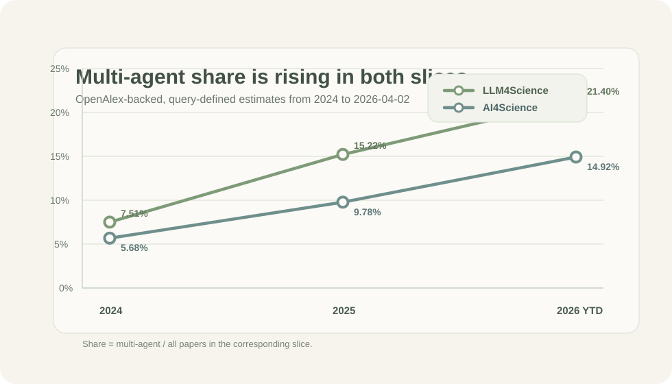

# Awesome Multi-Agent For Science

A curated list of papers, systems, and resources on multi-agent AI for scientific discovery and research automation.

## Table of Contents

- [Trend Snapshot](#trend-snapshot)
- [Scope](#scope)
- [Quality Bar](#quality-bar)
- [By Research Task](#by-research-task)
  - [Hypothesis Generation And Literature Review](#hypothesis-generation-and-literature-review)
  - [Experimental Design And Planning](#experimental-design-and-planning)
  - [Autonomous Experimentation And Execution](#autonomous-experimentation-and-execution)
  - [Data Analysis And Interpretation](#data-analysis-and-interpretation)
  - [Peer Review And Validation](#peer-review-and-validation)
  - [Scientific Writing And Communication](#scientific-writing-and-communication)
  - [Programming And Scientific Software Development](#programming-and-scientific-software-development)
- [Frameworks And Infrastructure](#frameworks-and-infrastructure)
  - [General MAS Frameworks](#general-mas-frameworks)
  - [Domain-Specific Platforms](#domain-specific-platforms)
  - [Communication And Coordination](#communication-and-coordination)
- [Failure Modes And Open Challenges](#failure-modes-and-open-challenges)
- [Contribution Guide](#contribution-guide)
- [License](#license)

## Trend Snapshot

OpenAlex-backed, query-defined trend estimates from `2024` to `2026-04-02`.



| Period | LLM4Science `multi-agent / all` | AI4Science `multi-agent / all` |
| --- | --- | --- |
| `2024` | `140 / 1864 = 7.51%` | `273 / 4804 = 5.68%` |
| `2025` | `415 / 2726 = 15.22%` | `630 / 6442 = 9.78%` |
| `2026 YTD` (`2026-01-01` to `2026-04-02`) | `245 / 1145 = 21.40%` | `322 / 2158 = 14.92%` |

The detailed methodology, keyword families, scripts, and lightweight result files live in [analysis/trend_of_mas4sci](./analysis/trend_of_mas4sci).

## Scope

This list focuses on:

- multi-agent LLM systems for scientific discovery
- role-specialized scientific agents
- autonomous or semi-autonomous research workflows
- planning, review, debate, verification, and experimentation in science
- infrastructure, evaluation, and failure modes for scientific MAS

The main organization is by `research task`. Scientific discipline is recorded as a `tag`, not a top-level section.

## Quality Bar

Every paper entry should:

- be checked against a primary source such as arXiv, a publisher page, a conference page, or an official project page
- use a real, public, direct URL
- match the stated `Tags` and `Agent pattern`
- clearly be about `multi-agent for science`, not an unrelated use of the word `agent`
- avoid duplicate entries across preprint and venue versions

If a paper is still ambiguous, keep it out of the main list until it is verified.

## By Research Task

Current coverage is centered on verified papers from `2024` to `2026 YTD`.

### Hypothesis Generation And Literature Review

- **[Two Heads Are Better Than One: A Multi-Agent System Has the Potential to Improve Scientific Idea Generation](https://arxiv.org/abs/2410.09403)**
  - Tags:   
  - Agent pattern: collaborative ideation
  - Why it matters: VirSci organizes multiple agents to generate, evaluate, and refine research ideas for autonomous scientific discovery.

- **[EvoScientist: Towards Multi-Agent Evolving AI Scientists for End-to-End Scientific Discovery](https://arxiv.org/abs/2603.08127)**
  - Tags:   
  - Agent pattern: researcher-engineer-manager
  - Why it matters: EvoScientist combines idea generation, experiment execution, and evolutionary memory in one multi-agent AI scientist workflow.

### Experimental Design And Planning

- **[Reasoning-Driven Design of Single Atom Catalysts via a Multi-Agent Large Language Model Framework](https://arxiv.org/abs/2602.21533)**
  - Tags:   
  - Agent pattern: specialized catalyst-design agents
  - Why it matters: MAESTRO uses specialized LLM roles to iteratively reason about and optimize single-atom catalyst candidates.

- **[MatPilot: an LLM-enabled AI Materials Scientist under the Framework of Human-Machine Collaboration](https://arxiv.org/abs/2411.08063)**
  - Tags:   
  - Agent pattern: human-machine multi-agent collaboration
  - Why it matters: MatPilot explicitly uses a multi-agent materials scientist setup to generate hypotheses and experimental schemes.

- **[MAC-AMP: A Closed-Loop Multi-Agent Collaboration System for Multi-Objective Antimicrobial Peptide Design](https://arxiv.org/abs/2602.14926)**
  - Tags:   
  - Agent pattern: closed-loop simulated peer review
  - Why it matters: MAC-AMP uses a multi-agent design-and-review loop to balance activity, toxicity, and novelty in peptide design.

### Autonomous Experimentation And Execution

- **[TianJi:An autonomous AI meteorologist for discovering physical mechanisms in atmospheric science](https://arxiv.org/abs/2603.27738)**
  - Tags:  
  - Agent pattern: meta-planner plus worker cohort
  - Why it matters: TianJi decomposes atmospheric science research into planning plus coordinated execution and analysis by specialized agents.

- **[Multi-Agent Collaboration for Automated Design Exploration on High Performance Computing Systems](https://arxiv.org/abs/2603.11515)**
  - Tags:  
  - Agent pattern: job-management, geometry, and inverse-design agents
  - Why it matters: MADA coordinates specialized agents around simulation-driven design exploration on HPC systems.

- **[Swarms of Large Language Model Agents for Protein Sequence Design with Experimental Validation](https://arxiv.org/abs/2511.22311)**
  - Tags:   
  - Agent pattern: decentralized swarm of residue-level agents
  - Why it matters: This work frames protein design as a distributed multi-agent search process and backs it with experimental validation.

### Data Analysis And Interpretation

- **[A Multi-agent Framework for Materials Laws Discovery](https://arxiv.org/abs/2411.16416)**
  - Tags:  
  - Agent pattern: multi-agent symbolic regression
  - Why it matters: This framework uses multiple LLM agents to derive interpretable materials laws from scientific data.

- **["DIVE" into Hydrogen Storage Materials Discovery with AI Agents](https://arxiv.org/abs/2508.13251)**
  - Tags:   
  - Agent pattern: multi-agent extraction and inverse design workflow
  - Why it matters: DIVE organizes agents to read figures and tables from the literature, build a structured database, and support rapid materials discovery.

- **[Sci-Mind: Cognitively-Inspired Adversarial Debate for Autonomous Mathematical Modeling](https://arxiv.org/abs/2603.27584)**
  - Tags:   
  - Agent pattern: theorist-critic debate with experiential memory
  - Why it matters: Sci-Mind treats mathematical modeling as a debate-and-verification process grounded by retrieval from prior scientific cases.

### Peer Review And Validation

- **[Towards Verifiable and Self-Correcting AI Physicists for Quantum Many-Body Simulations](https://arxiv.org/abs/2604.00149)**
  - Tags:   
  - Agent pattern: programming-verifier plus scientific-verifier
  - Why it matters: PhysVEC builds verification and error-correction directly into a multi-agent physics research workflow.

### Scientific Writing And Communication

- **[HLER: Human-in-the-Loop Economic Research via Multi-Agent Pipelines for Empirical Discovery](https://arxiv.org/abs/2603.07444)**
  - Tags:   
  - Agent pattern: human-in-the-loop multi-agent pipeline
  - Why it matters: HLER coordinates agents for data auditing, hypothesis generation, econometric analysis, manuscript drafting, and review in one empirical research pipeline.

### Programming And Scientific Software Development

- **[Mimosa Framework: Toward Evolving Multi-Agent Systems for Scientific Research](https://arxiv.org/abs/2603.28986)**
  - Tags:   
  - Agent pattern: meta-orchestrator plus code-generating agents
  - Why it matters: Mimosa automatically synthesizes and refines task-specific scientific multi-agent workflows with code-generating agents and tool use.

## Frameworks And Infrastructure

### General MAS Frameworks

- **[PiFlow: Principle-aware Scientific Discovery with Multi-Agent Collaboration](https://arxiv.org/abs/2505.15047)**
  - Tags:   
  - Agent pattern: principle-aware multi-agent discovery
  - Why it matters: PiFlow frames automated scientific discovery as structured uncertainty reduction guided by principles across multiple scientific domains.

- **[Open Source Planning & Control System with Language Agents for Autonomous Scientific Discovery](https://arxiv.org/abs/2507.07257)**
  - Tags:    
  - Agent pattern: planning-and-control orchestration
  - Why it matters: cmbagent presents a large multi-agent research stack with specialized roles for literature, code, interpretation, and critique.

- **[OrchMAS: Orchestrated Reasoning with Multi Collaborative Heterogeneous Scientific Expert Structured Agents](https://arxiv.org/abs/2603.03005)**
  - Tags:   
  - Agent pattern: orchestrator with heterogeneous expert agents
  - Why it matters: OrchMAS dynamically assembles domain-aware expert agents for long-horizon scientific reasoning tasks.

### Domain-Specific Platforms

- **[AGAPI-Agents: An Open-Access Agentic AI Platform for Accelerated Materials Design on AtomGPT.org](https://arxiv.org/abs/2512.11935)**
  - Tags:   
  - Agent pattern: planner-executor-summarizer
  - Why it matters: AGAPI unifies open materials APIs, simulations, and open-source LLMs through a multi-agent orchestration layer.

### Communication And Coordination

- **[MACC: Multi-Agent Collaborative Competition for Scientific Exploration](https://arxiv.org/abs/2603.03780)**
  - Tags:   
  - Agent pattern: collaborative competition
  - Why it matters: MACC studies how cooperation and competition can be combined to improve scientific exploration across multiple agents.

## Failure Modes And Open Challenges

- Technical failure modes: communication breakdown, coordination overhead, agent disagreement, and cascade failures.
- Scientific reliability issues: hallucination, unverifiable claims, invalid methodology, poor calibration, and reproducibility failures.
- Open problems: long-horizon planning, cross-domain integration, uncertainty handling, efficient coordination, and safety.

## Contribution Guide

Suggested entry format:

```markdown
- **[Paper title](paper-link)**
  - Tags: badges
  - Agent pattern:
  - Why it matters:
```

When adding papers, try to include:

- research task
- scientific discipline as tags
- whether the system is `multi-agent`, `other-agentic`, or mixed
- whether code, benchmark, or dataset artifacts are available

All paper and code links should be live, direct, and publicly accessible when added. For a stricter intake workflow, use [PAPER_ENTRY_TEMPLATE.md](./PAPER_ENTRY_TEMPLATE.md).

## License

This repository is licensed under Apache 2.0. See [LICENSE](./LICENSE).
